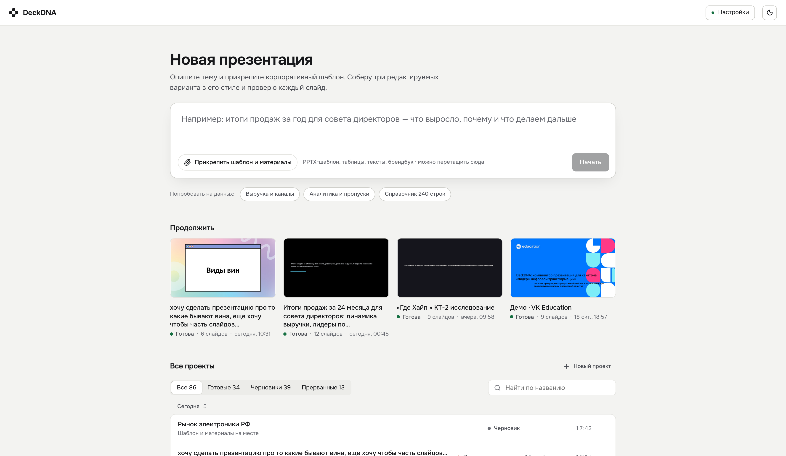
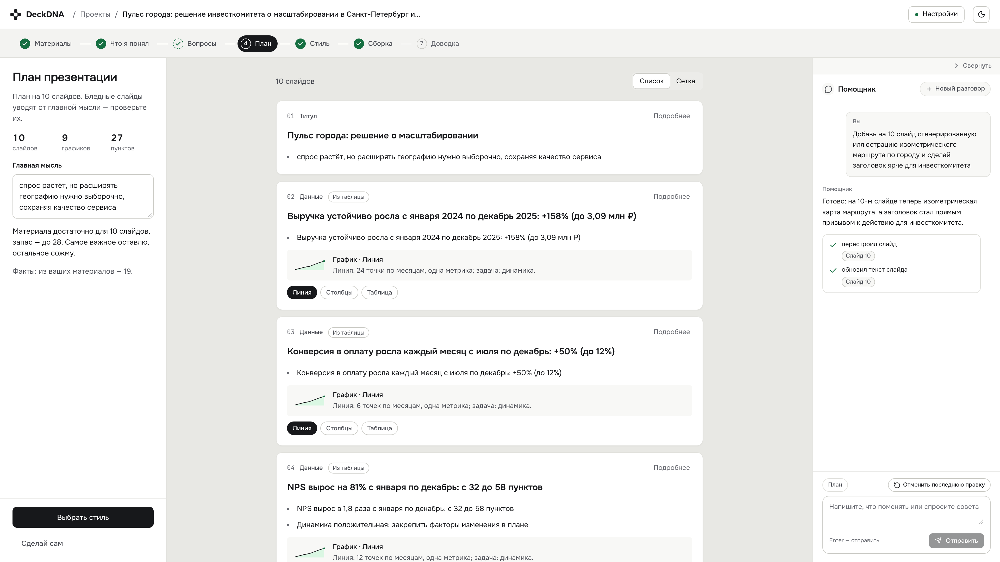
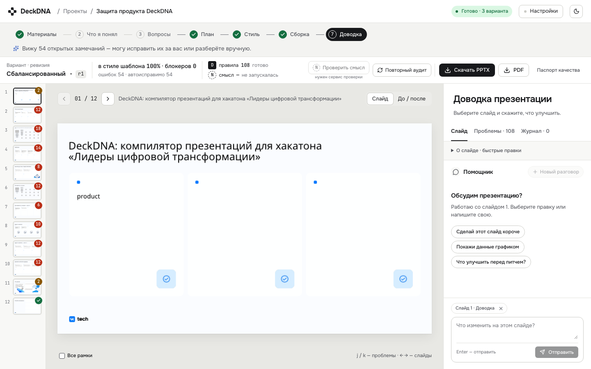
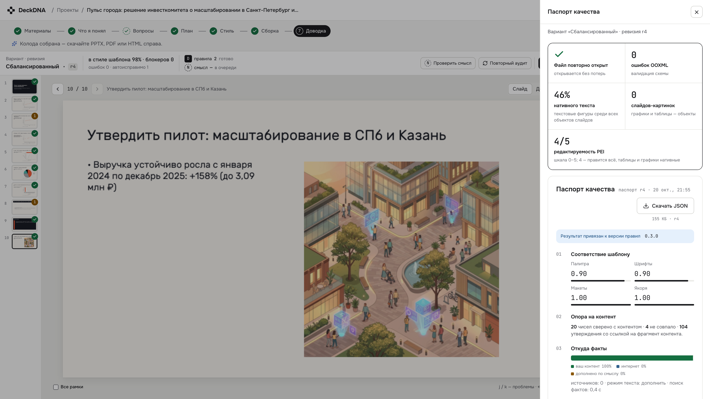
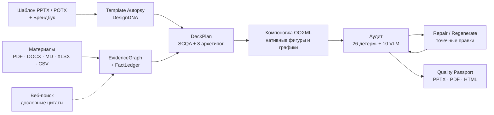
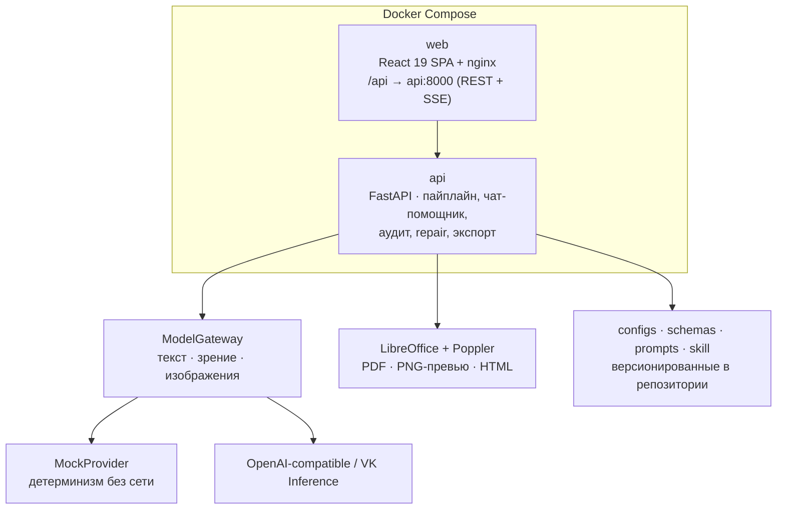

<p align="center">
  
</p>

<h1 align="center">DeckDNA — цифровой дизайнер презентаций</h1>

<p align="center">
  <a href="https://github.com/IT-AUL/case-14-ai-presentation-designer-team-19/actions/workflows/ci.yml"></a>
  <a href="https://github.com/IT-AUL/case-14-ai-presentation-designer-team-19/releases"></a>
  <a href="LICENSE"></a>
</p>

<p align="center">
  Загружаете шаблон, брендбук и материалы — получаете готовую колоду в фирменном стиле,
  с нативными графиками, прозрачным аудитом и редактируемым PowerPoint-файлом. Без ручной вёрстки.
</p>

<p align="center">
  <b>Демо-стенд: <a href="https://deckdna.it-aul.ru/">deckdna.it-aul.ru</a></b>
</p>

<p align="center">
  
</p>

---

**Содержание**

- [Возможности](#возможности)
- [Семишаговый процесс работы](#семишаговый-процесс-работы)
- [Как это работает](#как-это-работает)
- [Архитектура](#архитектура)
- [Быстрый старт](#быстрый-старт)
- [API: от брифа до готовой колоды](#api-от-брифа-до-готовой-колоды)
- [Провайдер моделей](#провайдер-моделей)
- [CLI, MCP и skill](#cli-mcp-и-skill)
- [Стек](#стек)
- [Релизы и обновления](#релизы-и-обновления)
- [Проверки качества](#проверки-качества)
- [Хранение данных и эксплуатация](#хранение-данных-и-эксплуатация)
- [Лицензия](#лицензия)

## Возможности

- **Семишаговый рабочий поток и диалоговый помощник.** Пошаговый мастер ведёт от загрузки исходников
  до финальной доводки (`Материалы → Что понял → Вопросы → План → Стиль → Сборка → Доводка`), а
  боковой чат-помощник умеет менять план, пересобирать отдельные слайды, запускать проверки и экспорт
  прямо из диалога.
- **Дизайн-DNA из любого шаблона и брендбука.** Система разбирает загруженную презентацию `.pptx`/`.potx`
  (мастер-слайды, макеты и реальные слайды-эталоны) и дополнительно принимает PDF/DOCX/MD-брендбук:
  извлекает палитру, типографику, отступы, сетки, логотипы и правила оформления.
- **Анализ таблиц и нативные диаграммы.** Табличные данные (`XLSX`, `CSV`, таблицы из документов)
  превращаются в `FactLedger` — реестр проверенных фактов и рядов с автоматическим выбором из 7 типов
  нативных редактируемых диаграмм PowerPoint (`column_clustered`, `column_stacked`, `column_100`, `bar`,
  `line`, `pie`, `doughnut`), KPI-карточек и таблиц.
- **Веб-исследование с проверкой цитат.** При нехватке фактов в исходных документах модуль исследования
  добирает подтверждённые сведения из внешних источников (`SearXNG` / `DuckDuckGo`), проверяет дословное
  присутствие цитаты на странице и выносит ссылки в сноски и библиографический слайд.
- **Детерминизм в центре, модель — по выбору.** Полный цикл сборки воспроизводим без внешних сервисов
  благодаря встроенному `MockProvider`. При подключении языковой и визуальной модели включаются
  SCQA-сторителлинг, реранжирование эталонов и контекстный VLM-аудит.
- **Три стратегии и восемь архетипов.** Один прогон собирает до трёх вариантов колоды (`faithful`,
  `balanced`, `visual`) на базе восьми архетипов вёрстки (`hero_stat`, `kpi_grid`, `process_steps`,
  `comparison_2col`, `cards_grid`, `chart_takeaway`, `table_summary`, `timeline`).
- **Проверки как код и точечный ремонт.** Каталог из 36 правил (26 детерминированных + 10 контекстных)
  фиксирует ошибки OOXML, выход за границы, контраст, плотность и смысловые расхождения. Доступны
  пакетное автоисправление и пересборка одного слайда без перегенерации всей колоды.
- **Quality Passport и честный экспорт.** Каждая колода сопровождается паспортом качества с метриками,
  хешами, версиями промптов и трассировкой каждого факта до источника. Экспорт в нативный `.pptx`,
  `.pdf` и веб-вьюер `.html`.

| План и архетипы | Аудит и доводка | Паспорт качества |
|:---:|:---:|:---:|
|  |  |  |
| Порядок, архетипы и тезисы правятся до вёрстки | Каждое замечание — правило, слайд и точечное действие | Метрики, время сборки, версии и источники |

## Семишаговый процесс работы

1. **Материалы.** Загрузка файлов (`.pptx`, `.potx`, `.pdf`, `.docx`, `.md`, `.txt`, `.xlsx`, `.csv`) или ввод свободного брифа.
2. **Что понял.** Сводка извлечённых фактов, таблиц, сущностей и ключевых метрик с привязкой к документам (`EvidenceGraph` + `FactLedger`).
3. **Вопросы.** Короткий список уточняющих вопросов (аудитория, цель, объём, акценты) с вариантами в один клик.
4. **План.** Раскадровка по слайдам (SCQA-дуга, вывод в заголовке, архетип макета, привязанные факты и диаграммы) с возможностью правок и drag-and-drop.
5. **Стиль.** Выбор или загрузка шаблона `.pptx`/`.potx`, подключение PDF/DOCX-брендбука и просмотр извлечённой `DesignDNA`.
6. **Сборка.** Генерация вариантов колоды с потоковым прогрессом по стадиям и превью слайдов.
7. **Доводка.** Послайдовый просмотр, аудит по 36 правилам, автоисправление геометрии/контраста, пересборка отдельных слайдов и скачивание `PPTX` / `PDF` / `HTML`.

## Как это работает



| Стратегия | Идея |
|---|---|
| `faithful` | максимально близко к эталонным слайдам шаблона |
| `balanced` | баланс фирменного стиля, плотности текста и визуальных акцентов |
| `visual` | приоритет диаграмм, карточек, таймлайнов и крупных метрик |

Подробное описание стадий, контрактов и ремонта — в [docs/ARCHITECTURE.md](docs/ARCHITECTURE.md) и [docs/AUDIT.md](docs/AUDIT.md).

## Архитектура



Все модельные вызовы изолированы за `ModelGateway`: по умолчанию включён офлайн-режим (`MockProvider`),
а при настройке внешнего эндпоинта подключаются OpenAI-совместимые серверы или VK Inference
([docs/MODELS.md](docs/MODELS.md)).

## Быстрый старт

### Готовые образы из реестра (без сборки)

```bash
git clone https://github.com/IT-AUL/case-14-ai-presentation-designer-team-19.git
cd case-14-ai-presentation-designer-team-19

DECKDNA_VERSION=v1.1.0 docker compose up -d --no-build --pull always
```

Альтернативный реестр — Docker Hub:

```bash
DECKDNA_REGISTRY=docker.io/renatgubaudullin DECKDNA_VERSION=v1.1.0 docker compose up -d --no-build --pull always
```

### Из исходников

```bash
docker compose up -d --build
```

Откройте `http://localhost:8080`. Интерактивная документация API — `http://localhost:8000/docs`.
Все настройки задаются через корневой `.env` (шаблон — в [`.env.example`](.env.example)). По умолчанию
сервис полностью автономен, сохраняет состояние в том `deckdna-artifacts` и не требует внешних ключей.

Проверка готовности после старта:

```bash
curl http://localhost:8000/healthz
curl http://localhost:8080/healthz
```

## API: от брифа до готовой колоды

```text
POST /api/v1/projects                                 → создать проект
POST /api/v1/projects/{id}/templates                  → загрузить шаблон PPTX/POTX
POST /api/v1/templates/{id}/brandbook                 → прикрепить брендбук (опционально)
POST /api/v1/projects/{id}/content-packs              → загрузить документы и таблицы
POST /api/v1/projects/{id}/plans                      → построить и отредактировать план
POST /api/v1/projects/{id}/generations                → собрать варианты колоды
POST /api/v1/variants/{id}/slides/{slideId}/regenerate→ пересобрать отдельный слайд
POST /api/v1/variants/{id}/exports                    → выгрузить PPTX / PDF / HTML
POST /api/v1/projects/{id}/agent/messages             → диалог с помощником (SSE)
```

Полный исполняемый `curl`-сценарий и справочник маршрутов — в [docs/contracts/API.md](docs/contracts/API.md),
машиночитаемая спецификация — в [`docs/contracts/openapi.json`](docs/contracts/openapi.json).

## Провайдер моделей

`MockProvider` активен по умолчанию (`DECKDNA_MOCK_PROVIDER=true`): весь пайплайн и тесты работают
офлайн и детерминированно. Для подключения реальных моделей задайте `DECKDNA_MOCK_PROVIDER=false` и
параметры `DECKDNA_PROVIDER_BASE_URL`, `DECKDNA_PROVIDER_API_KEY`, `DECKDNA_MODEL_TEXT`,
`DECKDNA_MODEL_VISION` (или создайте сессию провайдера прямо из веб-интерфейса). Подробности — в
[docs/MODELS.md](docs/MODELS.md).

## CLI, MCP и skill

Пайплайн доступен как CLI (`deckdna`), как переносимый скрипт `skill/run_skill.py` и как MCP-сервер
поверх `stdio`:

```bash
python3 skill/run_skill.py \
  tests/fixtures/pptx/synthetic_unseen.pptx \
  tests/fixtures/content/poc_article.md \
  /tmp/deckdna-out --slides 10

deckdna mcp   # запуск MCP-сервера (stdio)
```

Описание контракта и аргументов — в [skill/SKILL.md](skill/SKILL.md).

## Стек

| Слой | Технологии |
|---|---|
| Фронтенд | React 19, TypeScript, Vite, TanStack Query, Radix UI, CSS Modules, nginx |
| Бэкенд | Python 3.12, FastAPI, Uvicorn, Pydantic v2, MCP (`stdio`) |
| Документы и графики | OOXML (`python-pptx` + прямое редактирование XML), `openpyxl`, `pypdf`, LibreOffice, Poppler |
| Модели | `ModelGateway`: Mock / OpenAI-compatible / VK Inference (`qwen38-27b-fp8`, `flux.2-klein-4b`) |
| Качество | 26 детерминированных правил, 10 VLM-проверок, типизированный repair, послайдовая регенерация |
| Поставка | Docker Compose, GitHub Actions, multi-arch образы (`amd64`/`arm64`) → GHCR + Docker Hub |

## Релизы и обновления

Каждому релизу соответствует git-тег `vX.Y.Z` и опубликованные multi-arch образы в двух реестрах:

| Реестр | web | api |
|---|---|---|
| GHCR | `ghcr.io/it-aul/deckdna-web:v1.1.0` | `ghcr.io/it-aul/deckdna-api:v1.1.0` |
| Docker Hub | `docker.io/renatgubaudullin/deckdna-web:v1.1.0` | `docker.io/renatgubaudullin/deckdna-api:v1.1.0` |

Обновление локального стенда до нужной версии:

```bash
DECKDNA_VERSION=v1.1.0 docker compose up -d --no-build --pull always
```

## Проверки качества

```bash
pytest -q                                     # тесты бэкенда
cd frontend && npm test -- --run              # модульные тесты фронтенда
cd frontend && npm run lint && npm run build  # линтеры, FSD-границы и сборка
docker compose up -d --build                  # полный запуск в контейнерах
```

## Хранение данных и эксплуатация

- Состояние проектов, прогонов и сгенерированных артефактов сохраняется в постоянный Docker-том
  `deckdna-artifacts` (`/data/artifacts` внутри контейнера `api`), поэтому перезапуск или обновление
  контейнера сохраняет все пользовательские данные.
- Сетевые порты в `compose.yaml` по умолчанию привязаны к `127.0.0.1` для безопасного локального
  запуска и размещения за TLS reverse-proxy (`nginx` / `Caddy`).
- 26 детерминированных правил аудита работают полностью автономно; 10 контекстных VLM-проверок и
  генерация иллюстраций автоматически активируются при подключённом провайдере моделей.
- Веб-экспорт (`.html`) формирует автономный пакет со слайдами, векторными SVG-диаграммами и
  DOM-таблицами.

Полный перечень правил аудита и операций ремонта — в [docs/AUDIT.md](docs/AUDIT.md).

## Лицензия

Apache-2.0 — см. [LICENSE](LICENSE).
